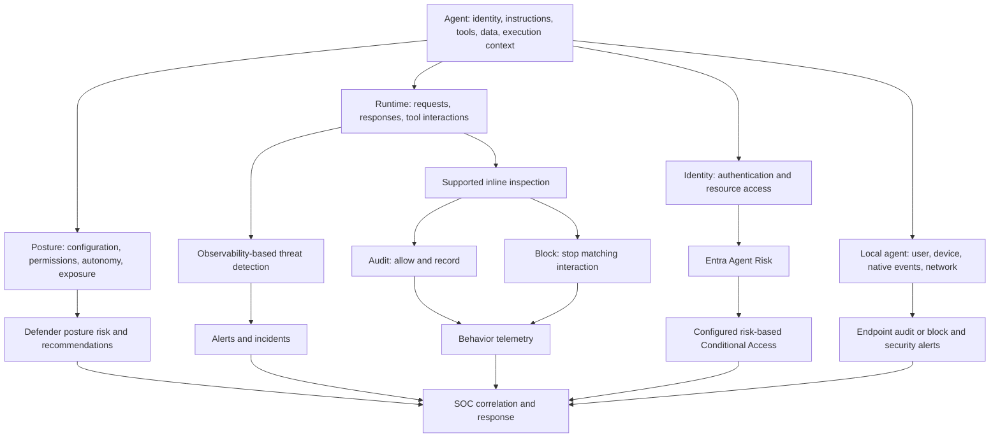

<p align="center">
  
</p>

<h1 align="center">What Makes an AI Agent Risky?</h1>

<p align="center">
  <strong>Microsoft Defender Detection and Protection</strong><br>
  <em>A technical reference for agent posture, runtime threats, identity risk, and security operations. Referenced from MS Learn and official public documentation.</em>
</p>

<p align="center">
  <a href="README.md">Agentic security hub</a> &middot;
  <a href="#risk-model">Risk model</a> &middot;
  <a href="#detections">Detections</a> &middot;
  <a href="#coverage">Coverage</a> &middot;
  <a href="#investigation">Investigation</a> &middot;
  <a href="#sources">Sources</a>
</p>

> **Documentation reviewed: 21 October 2026.** This guide brings together Microsoft Learn guidance with practical implementation and investigation examples. Preview availability, licensing, supported platforms, and enforcement requirements are noted in the relevant sections.

## Overview

An agent can be risky without being compromised. It might have broad write access, accept untrusted content, operate without human approval, or run under a highly privileged user. Alternatively, its activity might show an actual attack: prompt injection, credential disclosure, malicious tool use, or suspicious identity behavior.

This is exposed through different systems:

- **Defender posture risk** assesses exposure and potential impact using active risk indicators.
- **Defender threat detection** identifies suspicious activity from agent observability data.
- **Defender real-time protection** can audit or block matching interactions at supported inspection points.
- **Entra ID Protection Agent Risk** evaluates identity-related anomalies and compromise signals.
- **Defender for Endpoint** protects supported local agents through a separately configured runtime protection path.

**These are not interchangeable risk scores.** A Defender posture finding does not automatically establish identity compromise or trigger Entra risk-based Conditional Access. Inventory visibility does not prove that every tool call is inspected.

### Learning objectives

After reading this guide, you should be able to:

1. Distinguish posture exposure, attempted attacks, completed actions, and identity compromise.
2. Explain the broader detection scenarios and the four selectable cloud blocking categories.
3. Determine which agent execution paths are covered.
4. Configure a scoped audit-to-block validation exercise.
5. Investigate an agent using inventory, behaviors, alerts, identity events, and workload evidence.
6. Identify unsupported assumptions and telemetry gaps before declaring a deployment protected.

### Contents

1. [The risk model](#risk-model)
2. [Posture indicators and risk levels](#posture)
3. [Threat detection scenarios](#detections)
4. [The four real-time blocking categories](#blocking-categories)
5. [Audit, block, and evidence](#enforcement)
6. [Platform coverage matrix](#coverage)
7. [Entra identity risk](#identity-risk)
8. [Local endpoint agents](#endpoint)
9. [Onboarding and enforcement configuration](#configuration)
10. [SOC investigation and hunting](#investigation)
11. [Worked examples and validation](#examples)
12. [Knowledge check](#knowledge-check)
13. [Documentation and sources](#sources)

---

<a id="risk-model"></a>
## 1. The risk model: separate exposure from evidence

| Layer | Core question | Principal evidence | Main investigation surface |
| :--- | :--- | :--- | :--- |
| Defender posture | What makes the agent exposed or impactful? | Configuration, tools, access, runtime context, active indicators and alerts | Defender: Assets > AI agents |
| Defender threat detection | What suspicious or malicious activity occurred? | Agent observability, tool usage, execution patterns, alerts | Defender incidents, alerts, Advanced Hunting |
| Defender inline protection | Should this interaction continue? | Inspection result, rule scope, audit/block behavior | Real-time protection rules and behavior telemetry |
| Entra identity risk | Is the agent identity behaving anomalously or compromised? | Authentication and resource-access detections, administrator confirmation | Entra ID Protection: Risky Agents |
| Endpoint runtime protection | Is a supported local agent processing malicious instructions or attempting a harmful action? | Supported agent events or covered agent-to-model traffic | Defender for Endpoint alerts and device investigation |

### Risk-layer diagram



The diagram shows complementary controls with different purposes:

- **Defender posture risk is an exposure and impact assessment.** It combines active indicators about configuration, access, runtime context, and alerts into the risk level shown under **Assets > AI agents**. Use it to prioritize agents for review and hardening.
- **Entra Agent Risk is an identity-risk signal.** Entra ID Protection evaluates suspicious identity activity and administrator-confirmed compromise. Conditional Access can evaluate that signal when deciding whether the agent may access a protected resource.

For example, an agent can have elevated Defender posture risk because it legitimately writes to an important business system, without Entra identifying suspicious use of its identity. Conversely, suspicious use of an agent credential can require identity containment even if its configured resource permissions are narrow.

This is why **Defender posture risk is not the Entra Agent Risk condition**: the first helps prioritize exposure reduction; the second can drive identity-based access decisions. A posture level does not, by itself, set the Entra risk condition. Investigate both when assessing the agent's overall security.

Sources: [how Defender posture risk is assessed][posture-doc], [Entra ID Protection for agents][identity-doc], [Conditional Access for agents][ca-doc].

<details>
<summary><strong>Terminology: exposure, attempt, execution, compromise</strong></summary>

- **Exposure:** A condition that increases the possibility or impact of misuse, such as write access to a business system.
- **Attempt:** Suspicious input or a proposed action that may or may not succeed.
- **Execution:** A tool or workload actually performs an operation.
- **Compromise:** Evidence supports unauthorized control or misuse of an identity, agent, or environment.
- **Blocked interaction:** A supported control prevented that interaction at its inspection point. Earlier actions and alternative paths still require investigation.

These distinctions are analytical guidance. They are not additional detector names or scoring categories.

</details>

---

<a id="posture"></a>
## 2. Defender posture indicators and risk levels

Defender evaluates active indicators and combines their severity and relationships into an overall posture level. Indicators that are inactive or not assessed do not contribute.

*The public documentation does not provide a reproducible numerical scoring formula.*

### Documented indicator examples

| Indicator | Documented meaning | Technical review focus |
| :--- | :--- | :--- |
| Weak Instructions | Insufficient guidance for safe, predictable behavior | Explicit task boundaries, permitted actions, handling of untrusted content; enforce boundaries outside the prompt too |
| High-usage Agent | Multiple users use the agent and it may be operationally important | Number of affected users and business dependencies |
| Indirect Prompt Injection Exposure | Potential exposure to instructions embedded in external content | Knowledge sources, retrieved documents, web content, and tool outputs |
| Privileged Business-system Access | Write access to important business systems | Effective workload permissions, allowed operations, resource scope, approval boundaries |
| Active Threat | Active security alerts associated with the agent | Incident evidence, alert status, execution timeline, containment |

The table summarizes the [indicator examples published in Microsoft Learn](https://learn.microsoft.com/defender-xdr/security-for-ai/ai-agent-risk-assessment#agent-risk-indicators). That reference presents examples rather than a complete, versioned indicator catalog. To see which indicators were actually evaluated for an agent, open its **Overview** in **Defender > Assets > AI agents**; availability depends on platform support and data.

Published state, authentication, autonomy, tools, and sensitive-data access can also provide assessment context. A legitimate agent may intentionally need some of these capabilities.

### Local-agent context

Microsoft also lists examples such as **Used by a critical user**, **Running on a critical device**, **Running on a device with vulnerabilities**, and **Privileged Software Development Access**. An agent can inherit substantial impact from its user and device environment.

### Risk levels

| Level | Interpretation |
| :--- | :--- |
| High | A serious combination of active indicators; prioritize investigation |
| Medium | Notable risk requiring review and mitigation |
| Low | Minor active risk |
| No known risk | The assessment found no active indicators |
| Not evaluated | Information was insufficient for an assessment |

**Not evaluated is not a clean bill of health.** Likewise, No known risk does not guarantee the absence of a threat outside available coverage.

### Recommendations are a separate output

Recommendations map actionable configuration issues to relevant indicators. A high-risk agent can have no available recommendation; a lower-risk agent can have an actionable recommendation. Review the level, contributing indicators, recommendations, and active alerts together.

Source: [AI agent posture risk in Microsoft Defender][posture-doc].

---

<a id="detections"></a>
## 3. Broader threat detection scenarios

Defender analyzes agent observability data, tool use, and execution patterns for suspicious activity. **This section describes detection and investigation, not an inline blocking policy.** Near-real-time analytics identify suspicious activity and support alerts and incidents; enabling this telemetry path alone does not prevent a proposed tool action.

For supported inline enforcement, also configure the real-time protection path and blocking rules described in [sections 4 and 5](#blocking-categories). Local agents use the separate endpoint configuration in [section 8](#endpoint).

The documented near-real-time scenarios include:

| Scenario | What it concerns | Illustrative investigation question |
| :--- | :--- | :--- |
| Jailbreak attempts | Attempts to circumvent model or agent safeguards | Was the input rejected, or did subsequent actions depart from the legitimate task? |
| Indirect prompt injection / XPIA | Instructions introduced through retrieved or external content | Which document, page, or tool result introduced the instruction? |
| Malicious content propagation | Receiving, generating, or forwarding malicious content | Was the content encountered, delivered to a user, or passed to another tool? |
| Secret and credential leakage | Exposure of credentials or other secrets | Was a genuine credential disclosed, and does it require rotation? |
| Evasion techniques | Concealment intended to bypass controls | What was concealed, and what context establishes malicious intent? |
| LLM reconnaissance | Probing model or agent capabilities and restrictions | Do related requests form a reconnaissance sequence? |
| Suspicious user or IP access | Suspicious access context | Which user, address, session, and agent activity are correlated? |

These are documented scenario families, **not guaranteed exact alert titles or an exhaustive list of internal analytics**. The examples and questions in this guide are explanatory, not detection signatures.

An instruction-bearing document can create prompt-injection exposure before a detection exists. If Defender identifies suspicious instructions in a retrieved document, that is evidence the agent encountered an attack attempt. It is **not yet evidence that the agent obeyed those instructions**. Check subsequent tool calls and target-system logs to determine whether the requested action was proposed, blocked, or actually completed.

### Dependencies: detection versus enforcement

| Agent type or path | Detection and investigation prerequisites | Additional requirement for inline enforcement |
| :--- | :--- | :--- |
| Published Foundry agents | Agent 365 onboarding, Microsoft 365 connector, supported observability; playground-only agents are not supported for the documented near-real-time detection scenario | Supported Foundry real-time protection configuration and a blocking rule scoped to the agent; see [coverage](#coverage) and [cloud rule steps](#cloud-blocking-steps). Configure any additional Foundry safety controls using the [guardrails guide][foundry-guardrails-doc] |
| Copilot Studio agents | Agent 365 onboarding, Microsoft 365 connector, agent observability | Connect Copilot Studio real-time protection with the Power Platform administrator, then apply the supported cloud blocking policy |
| Microsoft Copilot Agent Builder declarative agents | The detection guide documents default observability, with Agent 365 and the Microsoft 365 connector | Validate the actual tool path: Work IQ MCP protection and Prompt Shields are documented integrations, not a guarantee that every agent interaction supports the four-category custom rule |
| Agents built on other platforms | The detection guide directs these agents to emit observability through the Agent 365 SDK; registering an agent alone is not sufficient | For the Agent 365 tool protection path, use supported Work IQ MCP tools or supported onboarded customer MCP tools; SDK observability alone does not add an inline enforcement point |
| Local endpoint agents | MDE onboarding, active Defender Antivirus, supported agent/version and inspection method | Enable agent-native and/or network inspection in Audit or Block through the endpoint settings; separate from cloud rules |

For all cloud rows, verify licensing, tenant availability, and actual telemetry ingestion before testing. The connector supplies investigation data; the inline integration supplies an opportunity to stop a supported action. Those functions are complementary.

Foundry guardrails can also define controls, inspection points, and response actions. A model's safety-filter configuration is not evidence that the separate Defender custom rule has been created; validate each intended control in its own configuration surface.

Sources: [detection prerequisites and scenarios][detection-doc], [runtime integration coverage][runtime-doc], [onboarding][setup-doc], [endpoint prerequisites][endpoint-setup-doc].

---

<a id="blocking-categories"></a>
## 4. The four selectable real-time blocking categories

The lists describe **different decision mechanisms**:

- **Near-real-time detection** analyzes observability and execution patterns to recognize suspicious activity and support investigation. It can consider behavior across an execution sequence.
- **Inline protection** evaluates an interaction at a supported intervention point and can stop it before it continues. Its custom cloud rule exposes four selectable threat scenarios.

Microsoft documents the broader analytics in [Detect AI agent threats in near-real-time](https://learn.microsoft.com/defender-xdr/security-for-ai/ai-agent-detection-protection#detect-ai-agent-threats-in-near-real-time) and the inline choices in [Supported threat scenarios for real-time protection](https://learn.microsoft.com/defender-xdr/security-for-ai/ai-agent-real-time-protection#supported-threat-scenarios-for-real-time-protection).

There is overlap, but no documented one-to-one mapping from every analytics scenario to a custom blocking category. For example, LLM reconnaissance appears in the detection guidance but is not a selectable fifth category in this rule wizard. Prompt injection also has platform-specific protection, including Prompt Shields; it should not be relabeled as one of the four categories without evidence of the actual control involved.

| Category | Matching concern | Supported intervention points, subject to platform coverage |
| :--- | :--- | :--- |
| Malicious content propagation | Content identified as malicious entering, leaving, or being forwarded by the agent | User request, model response, tool request, tool response |
| Secret exfiltration | Interactions exposing or attempting to transfer secrets such as keys, credentials, or tokens | User request, model response, tool request, tool response |
| Evasion techniques | Concealed or obfuscated malicious instructions/content | User request, model response, tool request, tool response |
| Unsafe email domain | A tool call attempting to send mail to an unsafe or untrusted domain | **Tool request only** |

The intervention-point list describes the category's documented behavior. It does **not** mean every platform supports all four points.

<details>
<summary><strong>Malicious content propagation: evidence and boundaries</strong></summary>

An agent may encounter a malicious URL in a tool result and then attempt to forward it. Depending on the supported inspection point, blocking can stop the result from reaching the model, the proposed tool request from executing, or the answer from reaching the user.

Collect the originating resource, tool, destination, timestamp, and action outcome. Distinguish reading malicious content from distributing it. Do not treat all external URLs as malicious or assume that every malicious item will be detected.

</details>

<details>
<summary><strong>Secret exfiltration: exposure is not the same as confirmed loss</strong></summary>

A tool can return a secret and the agent can attempt to include it in another interaction. Investigate whether the value is real, where it originated, and whether it crossed a trust boundary before the block.

Credential containment can require revocation or rotation even if one later transfer was blocked. Secret-exfiltration detection is not a guarantee that all confidential business data is classified or protected; it does not replace Microsoft Purview DLP or workload authorization.

</details>

<details>
<summary><strong>Evasion: investigate intent rather than encoding alone</strong></summary>

Encoding and obfuscation can conceal harmful instructions, but encoded content also has legitimate uses. Review the original content, transformed content where available, task context, and proposed action.

Do not assume that every encoded string is malicious, or that this detector exposes a configurable list of every encoding technique.

</details>

<details>
<summary><strong>Unsafe email domain: narrower than a general email-content rule</strong></summary>

This category acts on a proposed email-sending tool invocation. Merely mentioning an address in a prompt, answer, or tool result does not trigger this category's blocking.

The documentation describes unsafe/untrusted domain detection, not a configurable corporate recipient-domain allowlist. Use appropriate mail-flow, DLP, application policy, and authorization controls for broader recipient restrictions.

</details>

Source: [Supported threat scenarios for real-time protection][runtime-doc].

---

<a id="enforcement"></a>
## 5. Audit, block, alerts, and behaviors

### Cloud-agent enforcement comparison

| Property | Built-in Default rule | Custom blocking rule |
| :--- | :--- | :--- |
| Purpose | Observe matching activity | Stop selected matching interactions |
| Action | Audit; allow the action to continue | Block at the supported inspection point |
| Scope | Default audit coverage across agents | All or selected agents, with exclusions |
| Detection selection | Built-in audit behavior | Choose applicable categories from the four above |
| Real-time evidence | Behavior telemetry | Behavior telemetry |
| Near-real-time alerts | The runtime article documents alerting in audit mode | The runtime article says near-real-time alerts are not generated for an agent covered by a blocking rule |

The rule does not expand platform coverage or make unsupported tools inspectable.

### Plan SOC monitoring when moving from audit to block

The [real-time protection guidance](https://learn.microsoft.com/defender-xdr/security-for-ai/ai-agent-real-time-protection#how-real-time-protection-works) documents audit and block events as behaviors in **BehaviorInfo**, with related entities in **BehaviorEntities**. It also states that near-real-time detections generate alerts in audit mode, but not for an agent covered by a blocking rule.

> **Operational note:** Blocking prevents a matching interaction; an alert notifies an analyst. They are separate outcomes. When enabling cloud blocking, include behavior telemetry in SOC monitoring so that prevention events remain visible even when no native near-real-time alert is generated.

Before expanding a blocking policy:

1. Record the agent platform, published version, rule scope, categories, and exclusions.
2. Validate a supported test scenario and confirm the result at the runtime and target workload.
3. Check the behavior records and any alerts available for that integration.
4. If analyst notification is required, use supported hunting/custom detection and automation based on available telemetry; test notification separately from prevention.
5. Keep the resulting evidence with the deployment's acceptance criteria.

Platform-specific protections such as Prompt Shields and endpoint runtime protection have their own evidence paths. Use the relevant platform guide and verify the records available in the tenant. The cloud-rule alert behavior above does not imply that unrelated Defender detections stop generating alerts.

<a id="cloud-blocking-steps"></a>
### Put cloud-agent blocking into place

These steps configure **Defender Security for AI cloud real-time protection rules**, for supported agent paths described in [section 6](#coverage). They are not MDE device policies.

1. Complete [cloud onboarding and the applicable platform integration][setup-doc]. For Copilot Studio, coordinate with the Power Platform administrator to configure its protection connection.
2. In the Defender portal, open **Settings > Security for AI > Policies & rules > Real-time protection**.
3. Select **Create rule**.
4. On **Rule details**, enable the rule and enter a name and description.
5. Choose **specific pilot agents** initially rather than all agents. Review exclusions. The wizard's agent selection is limited to agents with a Microsoft Entra agent ID.
6. Select the required detection types from the four categories in [section 4](#blocking-categories), then select **Apply**.
7. Review the **Block** action, scope, categories, and enabled status; select **Create**.
8. Validate supported matching activity, a legitimate operation, and exclusions. Inspect behavior records and target-workload results.
9. Review accuracy and SOC visibility before broadening scope. Use **Edit rule**, **Enable**, **Disable**, and **Delete** to manage the rule.

The built-in Default rule stays an audit rule; enforcement is added through the custom blocking rule. For supported local agents, use the [MDE device configuration](#endpoint) instead.

Source: [Create a real-time protection rule](https://learn.microsoft.com/defender-xdr/security-for-ai/ai-agent-real-time-protection#create-a-real-time-protection-rule).

### Prompt evidence and sensitive information

The runtime article documents **Settings > Security for AI > Prompt evidence collection**, enabled by default. It includes only suspicious portions of user prompts or agent responses relevant to classification, with sensitive data and secrets redacted.

Microsoft Learn explicitly notes that **customer conversations might still be sensitive in nature** after redaction. For example, business context in a conversation can remain sensitive even if a credential is removed. See [Control prompt evidence in alerts](https://learn.microsoft.com/defender-xdr/security-for-ai/ai-agent-real-time-protection#control-prompt-evidence-in-alerts).

**Implementation guidance:** Limit evidence access to authorized investigators, apply the organization's retention requirements, and use synthetic content in demonstrations. These are evidence-handling practices for this guide, not additional configuration settings or verbatim requirements from the prompt-evidence article. The feature supports investigation; it is not a mechanism for collecting or recovering production secrets.

---

<a id="coverage"></a>
## 6. Platform coverage matrix

| Platform or execution path | Documented runtime coverage | Requirements and boundaries |
| :--- | :--- | :--- |
| Agent 365 tool invocations through Work IQ MCP | Tool invocations before execution | Includes supported onboarded customer MCP tools; unsupported tools and paths without Work IQ MCP integration are outside this integration's coverage |
| Copilot Studio, preview | Tool invocations | Configure the protection integration; it does not depend on Work IQ MCP |
| Microsoft Foundry, preview | User requests, agent responses, tool invocations, tool responses | Requires supported configuration; near-real-time threat detection is documented for **published agents only**, not playground-only agents |
| Local agents through Defender for Endpoint, preview | Supported agent-native events or covered agent-to-model network traffic; Audit and Block are available | Separate onboarding, active Defender components, supported agent/version/inspection method; configure endpoint policy or PowerShell as described in [section 8](#endpoint) |

Sources: [runtime coverage][runtime-doc], [threat detection prerequisites][detection-doc], [endpoint protection][endpoint-doc].

### Which MCP tool calls are protected?

Here, **MCP** means Model Context Protocol: an agent connects to an MCP server to call tools, such as a documentation search tool or a business-system API. This section concerns the **path used for those tool calls**, not whether the server is generally trustworthy.

For **Agent 365 tool protection**, the [runtime guide][runtime-doc] describes inspection through **Work IQ MCP**, including supported customer MCP tools onboarded to Agent 365. Connecting an arbitrary remote MCP endpoint directly to an agent does not, by itself, place that traffic through Work IQ MCP.

**Foundry and Copilot Studio also have platform-specific protection paths.** A direct MCP connection in Foundry must be evaluated against Foundry's supported runtime inspection; it should not automatically be classified as either protected or unprotected just because it bypasses Work IQ MCP.

For example, adding Microsoft Learn MCP to a Foundry agent proves that the agent can call a documentation tool. To demonstrate protection, separately verify the applicable Foundry integration, agent publication/configuration, rule, and resulting telemetry.

Validate:

1. Which runtime actually invokes the tool.
2. Which identity obtains resource access.
3. Whether the invocation crosses a supported inspection point.
4. Which protection integration and rule apply.
5. Which evidence proves the attempted and actual outcome.
6. Whether an alternate direct-access route bypasses that boundary.

Agent registry synchronization, inventory discovery, runtime observability, and inline enforcement are separate capabilities. Supported integrations can differ across platforms.

---

<a id="identity-risk"></a>
## 7. Entra ID Protection: identity-based risky agents

Entra evaluates risky activity associated with Entra Agent ID identities. Its Agent Risk is a separate assessment from Defender posture risk.

The following detection names and `riskEventType` values were checked against the [Microsoft Learn activities-contributing-to-risk table](https://learn.microsoft.com/entra/id-protection/concept-risky-agents#activities-contributing-to-risk). This is a reference table of detection types, not itself a Log Analytics table.

| Detection | Identity concern | riskEventType |
| :--- | :--- | :--- |
| Confirmed compromised | Administrator confirmation of compromise | `adminConfirmedAgentCompromised` |
| Early life malicious activity | A new agent quickly exhibits multiple suspicious patterns | `earlyLifeMaliciousActivity` |
| Entra Directory Reconnaissance | Suspicious reconnaissance or high-risk directory operations | `entraDirectoryReconnaissance` |
| Failed access attempt | Failed unauthorized resource access, potentially token replay | `failedAccessAttempt` |
| Microsoft Entra threat intelligence | Activity consistent with known attack patterns | `threatIntelligenceAccount` |
| Sign-in spike | Sign-in frequency above the agent's baseline | `signInSpike` |
| Suspicious credential usage | Newly added blueprint credentials are used | `suspiciousCredentialUsage` |
| Unfamiliar resource access | Resources outside the agent's usual access pattern | `unfamiliarResourceAccess` |

### What "offline" detection means

**Offline means asynchronous analysis after the underlying activity**, not a device disconnected from the internet. The activity occurs, Entra analyzes the signals, and the risk detection becomes available later. Microsoft does not publish a guaranteed completion time for these agent detections.

For example, a suspicious resource-access sequence can occur before the resulting agent-risk record is available. Once risk is established, a configured Conditional Access policy can evaluate Agent Risk on subsequent applicable access decisions. This is different from an inline tool control that decides whether a particular tool call may execute.

The current [activities table and its introductory text](https://learn.microsoft.com/entra/id-protection/concept-risky-agents#activities-contributing-to-risk) describe all listed agent detections as offline. The exported schema supports multiple timing values for extensibility; that schema is not a promise that every timing mode is implemented by these detectors.

### Learning mode: why a new POC agent may not generate an anomaly

Behavioral detections need a meaningful activity history. Entra's **Learning Mode** suppresses behavioral alerts when an agent lacks sufficient history, including onboarding and after inactivity. A separate early-life malicious activity detector operates in parallel so that learning does not exclude genuinely malicious early-life patterns.

This is not a global "turn off all detection" setting. The [How it works section](https://learn.microsoft.com/entra/id-protection/concept-risky-agents#how-it-works) does not publish a fixed learning duration, a training traffic count, or a switch to force an anomaly for a demo. Repeated sign-ins from a fresh agent therefore do not guarantee a Sign-in spike detection.

### On-behalf-of attribution

For on-behalf-of flows, Microsoft documents that risky activity is attributed to the **user**, rather than the agent, so remediation targets the affected user session without disrupting the agent for other users. Unless otherwise noted, the agent detections table applies to autonomous agent activity.

Investigate the user-risk reports and relevant user session when demonstrating delegated activity. An empty agent-risk report does not mean the user's activity was unassessed. Source: [the OBO note above the detection table](https://learn.microsoft.com/entra/id-protection/concept-risky-agents#activities-contributing-to-risk).

The [agent details report](https://learn.microsoft.com/entra/id-protection/concept-risky-agents#view-the-risky-agent-details) documents risk detections available for up to 90 days.

### Where the data lives and how to query it

| Information | Entra diagnostic export category | Log Analytics / Sentinel table | Record granularity |
| :--- | :--- | :--- | :--- |
| Individual agent identity detections | `AgentRiskEvents` | `AADAgentRiskEvents` | Detection event, including `AgentId` and `RiskEventType` |
| Agent risk state | `RiskyAgents` | `AADRiskyAgents` | Risk-state record; `Id` identifies the agent |

Configure **Entra ID > Monitoring & health > Diagnostic settings** to export those categories to the target Log Analytics workspace. Verify access permissions, ingestion, and retention. Run the examples in that workspace's **Logs** or its connected Sentinel workspace; these are not the Defender `BehaviorInfo` or `AgentsInfo` tables.

Sources: [export categories and table mapping][risk-export-doc], [event schema][agent-events-schema], [state schema][risky-agents-schema].

<details>
<summary><strong>KQL: agent detections and latest available agent risk state</strong></summary>

Detection events in the last seven days:

```kusto
AADAgentRiskEvents
| where TimeGenerated > ago(7d)
| project TimeGenerated, ActivityDateTime, DetectedDateTime,
    AgentId, AgentDisplayName, IdentityType, RiskEventType,
    RiskLevel, RiskState, DetectionTimingType, CorrelationId
| order by TimeGenerated desc
```

To narrow the query, add a `where AgentId == "<test-agent-id>"` clause or filter `RiskEventType`, for example `signInSpike`.

Latest risk-state record available within the selected seven-day period:

```kusto
AADRiskyAgents
| where TimeGenerated > ago(7d)
| summarize arg_max(TimeGenerated, *) by Id
| project TimeGenerated, Id, AgentDisplayName, IdentityType,
    RiskLevel, RiskState, RiskDetail, RiskLastModifiedDateTime,
    IsEnabled, IsDeleted, IsProcessing
| order by RiskLastModifiedDateTime desc
```

`AADAgentRiskEvents.AgentId` and `AADRiskyAgents.Id` use different column names. Do not join by display name. `TimeGenerated`, activity time, and detection time have different meanings; retain them when explaining delayed detection.

These read-only examples use published schema columns and have not been run against a customer tenant. A quiet agent might have no state update in the chosen window; widen the time range or inspect the Entra report before concluding that it has no risk.

</details>

Microsoft Graph also exposes the `agentRiskDetections` collection. The [documented beta list endpoint][agent-risk-api-doc] is:

```http
GET https://graph.microsoft.com/beta/identityProtection/agentRiskDetections
```

The list API documents `IdentityRiskEvent.Read.All`, appropriate roles for delegated access, and pagination. Follow `@odata.nextLink` when returned. Beta APIs can change and are not supported for production applications; use the version selector to check availability before designing a production integration.

### Response and enforcement

The Risky Agents experience offers **Confirm compromise**, **Confirm safe**, **Dismiss risk**, and **Disable** actions. Confirming compromise sets risk to High and can trigger an already configured Conditional Access policy that blocks High Agent Risk.

This is not a guarantee that changing a risk state terminates every already issued token or active workload session. Validate containment at the target resource and runtime.

Source: [ID Protection for agents][identity-doc]. For policy design, see [Conditional Access for agents][ca-doc].

### Pilot / POC: what can be demonstrated reliably?

Separate an **Entra risk event**, a **Defender alert**, and a **Conditional Access block**. They are not three names for the same result.

| Scenario | Documented expectation | Demo implication |
| :--- | :--- | :--- |
| New agent with insufficient history; activity intended to look unusual | Learning can suppress behavioral alerts | Do not promise an alert from a few rapid sign-ins or an unfamiliar test resource |
| Established autonomous agent with sufficiently suspicious behavior | A relevant offline detector can flag risk after analysis | Detector thresholds, timing, and outcome are not published; unsuitable as the only live-demo path |
| New agent exhibiting malicious early-life patterns | A separate early-life detector runs during learning | Coverage remains, but no guaranteed public trigger recipe is documented for this detector |
| Suspicious OBO activity | Risk is attributed to the user | Demonstrate the user/session investigation, not an expected agent-risk entry |
| Administrator confirms compromise on a test agent available in Risky Agents | Risk becomes High and an administrator-confirmed detection event is created | Demonstrates risk-state handling and configured policy response, **not automatic threat detection or a guaranteed native Defender alert** |

**Controlled risk-response walkthrough:**

1. Use an authorized test tenant and disposable agent. Prepare a pilot-scoped Agent Risk Conditional Access policy, initially in report-only, and validate the target identity.
2. Open **Entra ID Protection > Risky Agents**. The documented confirmation action operates on an agent available in that report; do not assume an unflagged new agent can be added through this screen.
3. Where a suitable test agent is available, use **Confirm compromise** only as an explicitly labeled test. Verify High risk and the `adminConfirmedAgentCompromised` detection.
4. Review report-only policy evaluation; enforce only for the approved pilot scope. Acquire a fresh token through the intended autonomous path and review the applicable access result and sign-in evidence.
5. If the demo requires a SOC notification, configure and test an appropriate rule/notification workflow using exported risk events. Label that notification as your configured workflow, not an automatically promised built-in alert.
6. After testing, use the appropriate risk-remediation action and restore pilot configuration. Verify access before returning the agent to service.

This walkthrough validates the documented response action and policy behavior. It does not seed a risk event for an arbitrary unflagged identity. The general [ID Protection simulation guide][risk-simulation-doc] covers user/workload scenarios; do not substitute its risky-user APIs for agent APIs.

**If a predictable Defender alert is the POC goal**, use the separately documented [local-agent runtime-protection demonstration][endpoint-demo-doc] with its prerequisites. That demonstrates endpoint protection, not an Entra identity anomaly. There is no guaranteed automatic Entra agent-detector trigger procedure in the agent-risk reference cited here.

---

<a id="endpoint"></a>
## 8. Local agents: endpoint-specific protection

Local coding assistants, desktop apps, and CLI agents can operate with their user's permissions. Device context therefore changes the potential impact.

| Inspection method | How it works | Important limitation |
| :--- | :--- | :--- |
| Agent-native events | Uses vendor-supported interfaces to inspect available agent events | The supported interfaces determine inspection and intervention opportunities |
| Network inspection | Inspects covered agent-to-LLM traffic | Coverage is constrained by the support matrix; certificate pinning and HTTP/3 are documented limitations |

### What enforces the block?

**Defender on the endpoint performs enforcement.** Intune or the Defender portal distributes policy; neither is a requirement for a local elevated PowerShell pilot.

The local-agent controls are **runtime inspection modes**, not the four-category cloud rule wizard:

| Setting | Inspection method | Modes |
| :--- | :--- | :--- |
| `AiAgentProtection` | Agent-native event inspection | `Disabled`, `Audit`, `Block` |
| `AiAgentNetworkInspection` | Covered agent-to-model network traffic | `Disabled`, `Audit`, `Block` |

In Audit, the detected action is allowed and reported. In Block, Defender stops supported detected actions. The setup guide documents **Suspicious AI prompt injection** alerts in both modes: Informational in audit, and risk-assessed severity in block. This endpoint alert behavior is separate from the cloud-rule near-real-time alert behavior.

These settings do not expose custom per-category prompt-injection signatures, arbitrary prompt rules, or the cloud four-category selector. ASR rules, network indicators, and other MDE controls are separate controls; do not describe them as this AI-agent policy.

### Prerequisites for an endpoint pilot

- Applicable licensing from the [runtime-protection prerequisites](https://learn.microsoft.com/defender-endpoint/configure-ai-agent-runtime-protection#prerequisites).
- A supported Windows device onboarded to MDE, with Defender Antivirus active and real-time protection enabled.
- A supported agent/version and inspection method from the [support matrix][endpoint-matrix-doc].
- Current platform/engine updates. During preview, the guide requires test devices on the **Beta Channel**; the setup guide specifies signature version `1.451.224.0` or later.
- Appropriate permissions for local configuration, endpoint policies, and alert investigation.

### Option A: configure one test device without Intune

Run these commands in an **elevated PowerShell window on the authorized test device**, not in the agent chat. They are configuration examples, not commands executed by this guide.

Verify readiness and current configuration:

```powershell
Get-MpComputerStatus |
    Select-Object AMRunningMode, RealTimeProtectionEnabled, AntivirusSignatureVersion

Get-MpPreference |
    Select-Object AiAgentProtection, AiAgentNetworkInspection,
        PlatformUpdatesChannel, EngineUpdatesChannel
```

Start with agent-native inspection in audit mode:

```powershell
Set-MpPreference -AiAgentProtection Audit
```

After reviewing the pilot, enable blocking:

```powershell
Set-MpPreference -AiAgentProtection Block
```

For a supported network-inspection scenario, configure that method separately:

```powershell
Set-MpPreference -AiAgentNetworkInspection Audit
# After validating the supported network-inspection scenario:
Set-MpPreference -AiAgentNetworkInspection Block
```

Verify the effective values with `Get-MpPreference`, close existing agent/terminal sessions, and start a fresh terminal. Central policy or tamper protection can constrain local changes; inspect effective policy and coordinate with the endpoint administrator rather than bypassing those controls.

Source: [Enable runtime protection](https://learn.microsoft.com/defender-endpoint/configure-ai-agent-runtime-protection#enable-runtime-protection).

### Option B: deploy from the Defender portal without Intune enrollment

For devices managed through **MDE security settings management**:

1. Complete the [security settings management prerequisites and tenant configuration][mde-settings-doc]. This uses the supported Intune/Defender policy infrastructure, but devices need not be enrolled in Intune.
2. Open **Endpoint security policies** in the Defender portal at `https://security.microsoft.com/policy-inventory`.
3. On **Windows policies**, select **Create new policy**.
4. Select **Windows** and the **Microsoft Defender AI agent runtime protection** template.
5. Configure **Ai Agent Protection** to **Audit** for the pilot.
6. Assign the policy to the appropriate **Microsoft Entra device group**. User targeting is not supported for devices managed through MDE security settings management without Intune enrollment.
7. Check the target device's **Configuration management > Effective settings** for **Ai Agent Protection**, its source, and effective value.
8. Validate detections; change the policy to **Block** when ready. Restart agent/terminal sessions and verify again.

The documented template configures **agent-native inspection**. The setup guide describes network inspection through `Set-MpPreference`; do not assume the template also configures network inspection. For organizations without Intune script deployment, use an authorized existing device-management mechanism to apply the documented PowerShell setting and verify its effective result.

**Licensing note:** MDE security settings management has its own subscription, connectivity, and policy requirements. The reference documents access with an eligible MDE subscription and a limitation for Defender-for-Servers-only licensing. "No Intune enrollment" does not mean there are no management-service prerequisites.

Sources: [Defender-portal AI policy deployment](https://learn.microsoft.com/defender-endpoint/configure-ai-agent-runtime-protection#deploy-settings-throughout-your-organization-with-the-microsoft-defender-portal), [endpoint policy management][mde-policy-doc], [security settings management licensing][mde-settings-doc].

### Option C: deploy with Intune

Where Intune is used, create the Windows **Microsoft Defender AI agent runtime protection** profile under endpoint security Antivirus policy and assign it to the pilot devices. The setup guide documents a separate PowerShell deployment for network inspection. Intune is a deployment option, not the inline threat detector.

### Verify a local alert and block

Use Microsoft's [benign runtime-protection demonstration][endpoint-demo-doc] exactly as documented, with agent-native inspection, the preview update channel, a supported agent, and fresh terminal sessions.

- **Audit:** The test is allowed and an Informational **Suspicious AI prompt injection** alert is documented.
- **Block:** The test is blocked, with Defender evidence and a security alert.
- **Agent refusal alone:** Not proof of Defender detection; a model can refuse without Defender generating evidence.

Review Protection history, the device timeline, and Defender alerts. For example, the demonstration documents this read-only hunting query:

```kusto
AlertInfo
| where Timestamp > ago(24h)
| where Title has "AI prompt injection"
    or Title has "Suspicious AI prompt injection"
| project Timestamp, AlertId, Title, Severity, Category, ServiceSource
| order by Timestamp desc
```

Prepare separate pilot devices or record and restore original settings between approved audit/block tests. Do not switch production devices to the preview update channel for a demonstration.

Sources: [endpoint runtime protection][endpoint-doc], [supported-agent matrix][endpoint-matrix-doc], [endpoint configuration][endpoint-setup-doc].

---

<a id="configuration"></a>
## 9. Onboarding and enforcement configuration

### Establish coverage first

1. Verify applicable licensing and tenant eligibility.
2. Onboard to Agent 365 and check **Defender > Settings > Security for AI > Get started**.
3. Verify Security for AI data collection and the Microsoft 365 connector.
4. Confirm the required connector components, including **Microsoft Entra ID Management events** and **Microsoft 365 activities**. Entra Users and groups is documented as a monitoring prerequisite.
5. Verify observability for the agent's platform. The threat-detection guide directs agents built on other platforms to Agent 365 SDK observability.
6. Publish Foundry agents before validating the documented near-real-time threat-detection scenario.
7. Configure the Copilot Studio protection connection when testing that platform.
8. Onboard local agents separately through Defender for Endpoint.

> **Licensing note:** Effective **1 July 2026**, the documented transition places the relevant Foundry and Copilot Studio agent-security capabilities under **Microsoft Agent 365** licensing. Before rollout, confirm the tenant's current entitlement and onboarding against the [Agent 365 transition guide][transition-doc]. Entra ID Protection and local MDE runtime protection also have feature-specific prerequisites; use the licensing section of each linked implementation guide.

Sources: [onboarding][setup-doc], [detection prerequisites][detection-doc], [Agent 365 transition][transition-doc], [Entra prerequisites][identity-doc].

### Choose the correct enforcement configuration

| Protection target | Configuration procedure | Scope |
| :--- | :--- | :--- |
| Supported cloud agents: Foundry, connected Copilot Studio, supported Agent 365 tool paths | [Create the Security for AI blocking rule](#cloud-blocking-steps) | Agent selection/exclusions and supported detection categories |
| Supported local Windows agents | [Configure MDE runtime protection](#endpoint) through PowerShell, Defender-portal policy, or Intune | Devices and supported inspection methods |
| Risky autonomous Entra agent identities | [Risk-based Conditional Access][ca-doc] | Agent identity scope, risk condition, protected resources |

Select the supported platform path, not just the agent's name in an inventory. A cloud blocking rule does not configure device inspection, and an MDE device policy does not set Entra Agent Risk.

---

<a id="investigation"></a>
## 10. SOC investigation and hunting

### Investigation checklist

- [ ] Identify the signal: posture, alert, behavior/block, identity risk, or endpoint detection.
- [ ] Record agent ID, platform, published version, identity, owner/sponsor context, and timestamps.
- [ ] Review active indicators and recommendations without assuming compromise.
- [ ] Establish effective permissions and resource scopes in the target workloads.
- [ ] Reconstruct the request, retrieved content, model interaction, tool request, tool result, and output.
- [ ] Identify the source of suspicious instructions or content.
- [ ] Separate attempted actions from completed operations using target-workload evidence.
- [ ] Record the enforcement point, active rule, scope, and exclusions.
- [ ] Check related users, identities, tools, destinations, and agents for wider impact.
- [ ] Contain using the appropriate identity, runtime, resource, or endpoint control.
- [ ] Rotate/revoke exposed credentials when warranted.
- [ ] Preserve evidence and validate that containment actually prevented further access.
- [ ] Correct the underlying exposure before restoring service.

### Hunting data sources

| Table | Investigation purpose |
| :--- | :--- |
| `AgentsInfo` | Inventory and configuration snapshots |
| `CloudAppEvents` | Agent 365 observability, tool activity, and data-access context |
| `AlertInfo` | Alert metadata |
| `AlertEvidence` | Entities and artifacts related to alerts |
| `BehaviorInfo` | Real-time audit/block behavior records |
| `BehaviorEntities` | Entities associated with behaviors |

For **Entra identity-risk events**, use the separate workspace exports `AADAgentRiskEvents` and `AADRiskyAgents` described in [section 7](#identity-risk), rather than assuming those records appear in the cloud-agent behavior tables.

Availability depends on onboarding, licensing, platform telemetry, permissions, and retention. An empty result is not evidence that the activity was safe.

<details>
<summary><strong>Example KQL: latest available agent inventory</strong></summary>

The following query is documented in the [inventory guide][inventory-doc]. It is read-only and has not been executed against a tenant for this article.

```kusto
AgentsInfo
| summarize arg_max(Timestamp, *) by AgentId
| where LifecycleStatus != "Deleted"
```

Use the Advanced Hunting time picker to define the investigation window. The query returns the latest available snapshot within that window, which is not necessarily the current live configuration.

`AgentsInfo` replaces the previous `AIAgentsInfo` table in the Agent 365 transition. Use Microsoft-maintained **Queries > AI Agents** samples and inspect the current schema before authoring joins. Do not assume the agent's display name is a unique or stable cross-table key.

</details>

### Evidence-handling guidance

Preserve identifiers, timestamps, correlation IDs, action outcomes, relevant tool/resource metadata, and rule configuration. Avoid copying raw tokens, production secrets, or full sensitive documents into tickets. Retain necessary protected evidence in approved investigation systems.

Source: [investigation and hunting][detection-doc], [inventory snapshots][inventory-doc].

---

<a id="examples"></a>
## 11. Worked examples and controlled validation

The examples below illustrate reasoning and evidence collection. They are not guaranteed detector triggers or tested product demonstrations.

### Example A: a high-impact agent without a confirmed attack

An agent writes to a business system and is used by many employees.

- **Posture:** Privileged Business-system Access and High-usage Agent may be relevant, depending on assessment support and data.
- **Threat conclusion:** No compromise can be inferred from those capabilities alone.
- **Action:** Validate least privilege, resource boundaries, approvals, ownership, and monitoring.
- **Evidence:** Effective permissions, tool configuration, assessment output, and legitimate business purpose.

### Example B: suspicious instructions in a tool response

A public documentation tool returns content that attempts to redirect the agent away from the legitimate user task.

- **Exposure:** The tool output is untrusted input, not an instruction authority.
- **Detection:** Indirect prompt injection is a documented threat scenario.
- **Enforcement:** Depends on the platform and supported intervention point; do not assume it is one of the four selectable categories by name.
- **Evidence:** Source resource, tool response, subsequent proposed action, behavior/alert, and target operation outcome.

### Example C: a secret-bearing operation is blocked

An agent proposes an operation containing a value classified as a secret.

- **Detection category:** Secret exfiltration can apply where supported.
- **Outcome:** A block at one point does not establish whether an earlier response already exposed the value.
- **Action:** Confirm whether the value is real, investigate prior access, and rotate/revoke credentials if needed.

### Example D: unusual identity activity

An autonomous agent begins accessing resources outside its established pattern.

- **Identity layer:** Unfamiliar resource access can contribute to Entra Agent Risk.
- **Timing:** Detection is documented as offline, not an inline tool gate.
- **Action:** Correlate identity events with tool and workload evidence. Use configured risk-based Conditional Access or disablement when appropriate.

### Validation matrix

| Test objective | Evidence to collect | What the result does not prove |
| :--- | :--- | :--- |
| Confirm inventory | Agent record and correct identity/platform | Every execution path is protected |
| Confirm audit | Allowed action plus matching telemetry from an approved scenario | All harmful activity would be detected |
| Confirm blocking | Matching behavior, applied rule, runtime result, and target-workload outcome | Earlier actions were harmless |
| Confirm scope | Intended agent covered; deliberate exclusion behaves as configured | Unsupported agents gained protection |
| Confirm SOC visibility | Available behaviors, alerts, entities, and correlation context | Every block creates a native incident |
| Confirm containment | Subsequent access fails through the relevant runtime/resource paths | Existing tokens were universally invalidated |

Use synthetic data, disposable identities/resources, and an authorized test plan. Do not use real secrets, live malicious destinations, or production customer content. Arbitrary placeholder strings are not guaranteed to trigger a detector. For local agents, prefer Microsoft's [runtime-protection demonstration][endpoint-demo-doc].

---

<a id="knowledge-check"></a>
## 12. Knowledge check

<details>
<summary><strong>Does High Defender posture risk automatically trigger High Agent Risk Conditional Access?</strong></summary>

No. They are separate assessments. Entra Conditional Access evaluates its supported conditions, including Entra Agent Risk; do not assume a Defender posture level sets that condition.

</details>

<details>
<summary><strong>Are the four blocking categories the complete threat-detection catalog?</strong></summary>

No. They are the selectable categories for the documented custom cloud blocking rules. The broader detection guide also discusses jailbreaks, indirect prompt injection, reconnaissance, and suspicious access.

</details>

<details>
<summary><strong>Does a listed MCP server prove its tool calls are protected?</strong></summary>

No. Validate the runtime, identity, supported integration, inspection point, rule scope, and evidence.

</details>

<details>
<summary><strong>Does an unsafe address mentioned in a model response trigger Unsafe email domain blocking?</strong></summary>

Not by itself. That scenario is evaluated at the tool-request point for an attempted email send.

</details>

<details>
<summary><strong>Can a playground-only Foundry agent validate the documented near-real-time threat-detection scenario?</strong></summary>

No. The threat-detection prerequisites specify published Foundry agents. Verify the published execution path and telemetry.

</details>

---

<a id="sources"></a>
## 13. Documentation and sources

This guide brings together Microsoft Learn documentation with implementation steps, investigation examples, and pilot validation guidance. References were reviewed on **21 October 2026**. Follow the linked feature guides for current availability, prerequisites, configuration, and supported behavior; preview capabilities can evolve. Examples identify the evidence to validate before extending a pilot into production.

| Reference | What to verify |
| :--- | :--- |
| [AI agent posture risk][posture-doc] | Indicators, assessment levels, recommendations |
| [Agent inventory and posture investigation][inventory-doc] | Portal workflow, inventory snapshots, documented KQL |
| [Detect and investigate agent threats][detection-doc] | Detection scenarios, observability, published Foundry requirement, hunting tables |
| [Real-time protection][runtime-doc] | Four blocking categories, platform coverage, audit/block semantics, prompt evidence |
| [Security for AI onboarding][setup-doc] | Connector components and Copilot Studio integration |
| [Agent 365 transition][transition-doc] | Licensing transition and inventory table changes |
| [Entra ID Protection for agents][identity-doc] | Identity detections, attribution, timing, report actions |
| [Conditional Access for agents][ca-doc] | Identity-targeted access policy design |
| [Endpoint runtime protection][endpoint-doc] | Local agent inspection, modes, alerts, limitations |
| [Endpoint support matrix][endpoint-matrix-doc] | Agent/version/inspection-method coverage |
| [Endpoint configuration][endpoint-setup-doc] | Setup and investigation workflow |
| [Endpoint demonstration][endpoint-demo-doc] | Microsoft's controlled validation exercise |
| [Export identity risk data][risk-export-doc] | Diagnostic categories and workspace table mapping |
| [Agent identity detection schema][agent-events-schema] | `AADAgentRiskEvents` columns |
| [Risky agent state schema][risky-agents-schema] | `AADRiskyAgents` columns |
| [List agent risk detections, Graph beta][agent-risk-api-doc] | Query permissions, API version, pagination |
| [ID Protection simulation guidance][risk-simulation-doc] | Documented simulations; distinguish user/workload tests from agent detections |
| [Defender endpoint policy management][mde-policy-doc] | Defender-portal policy creation and prerequisites |
| [MDE security settings management][mde-settings-doc] | Deployment without Intune device enrollment, licensing, and tenant configuration |
| [Foundry guardrails and controls][foundry-guardrails-doc] | Platform safety controls and intervention points, distinct from creating a Defender rule |

[posture-doc]: https://learn.microsoft.com/defender-xdr/security-for-ai/ai-agent-risk-assessment
[inventory-doc]: https://learn.microsoft.com/defender-xdr/security-for-ai/ai-agent-inventory
[detection-doc]: https://learn.microsoft.com/defender-xdr/security-for-ai/ai-agent-detection-protection
[runtime-doc]: https://learn.microsoft.com/defender-xdr/security-for-ai/ai-agent-real-time-protection
[setup-doc]: https://learn.microsoft.com/defender-xdr/security-for-ai/get-started-defender-security-for-ai
[transition-doc]: https://learn.microsoft.com/defender-xdr/security-for-ai/transition-agent-security-to-agent-365
[identity-doc]: https://learn.microsoft.com/entra/id-protection/concept-risky-agents
[ca-doc]: https://learn.microsoft.com/entra/identity/conditional-access/agent-id
[endpoint-doc]: https://learn.microsoft.com/defender-endpoint/ai-agent-runtime-protection-overview
[endpoint-matrix-doc]: https://learn.microsoft.com/defender-endpoint/ai-agent-support-matrix
[endpoint-setup-doc]: https://learn.microsoft.com/defender-endpoint/configure-ai-agent-runtime-protection
[endpoint-demo-doc]: https://learn.microsoft.com/defender-endpoint/defender-endpoint-demonstration-ai-agent-runtime-protection
[risk-export-doc]: https://learn.microsoft.com/entra/id-protection/howto-export-risk-data
[agent-events-schema]: https://learn.microsoft.com/azure/azure-monitor/reference/tables/aadagentriskevents
[risky-agents-schema]: https://learn.microsoft.com/azure/azure-monitor/reference/tables/aadriskyagents
[agent-risk-api-doc]: https://learn.microsoft.com/graph/api/identityprotectionroot-list-agentriskdetections?view=graph-rest-beta
[risk-simulation-doc]: https://learn.microsoft.com/entra/id-protection/howto-identity-protection-simulate-risk
[mde-policy-doc]: https://learn.microsoft.com/defender-endpoint/endpoint-security-policies-configure
[mde-settings-doc]: https://learn.microsoft.com/intune/device-security/microsoft-defender/security-settings-management
[foundry-guardrails-doc]: https://learn.microsoft.com/azure/foundry/guardrails/guardrails-overview

---

[Back to the Agentic security hub](README.md)
